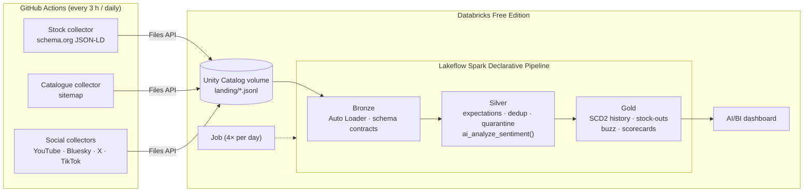

# Rituals Radar

**Stock monitoring and social sentiment for Rituals products, built end-to-end on Databricks Free Edition.**

Every 3 hours the radar checks whether a watchlist of products is in stock on rituals.com/nl-nl and records price changes. Once a day it collects what people say about each Rituals collection on YouTube, Bluesky, X and TikTok. A Lakeflow pipeline turns the raw data into a stock history, stock-out periods, sentiment per post and per collection, and a scorecard that puts buzz and availability side by side. An AI/BI dashboard sits on top.

> Non-commercial portfolio project. It is not affiliated with Rituals Cosmetics.

## Questions it answers

- Which products are sold out right now, since when, and how often did that happen in the last 30 days?
- How do prices and discounts change over time?
- Which collections get the most attention (share of voice), and is the tone positive or negative?
- Do the collections people talk about most also sell out most?
- Which new products appeared in the catalogue?

## Architecture



**Why the collectors run outside Databricks:** Free Edition only allows outbound traffic to a small allowlist of domains, so notebooks can't reach rituals.com or the social APIs. GitHub Actions fetches the data and uploads raw JSON Lines to a Unity Catalog volume, and everything after that happens in Databricks. If your workspace does get internet access, for example after the optional LinkedIn verification, the same code can run as a Databricks job instead (`resources/optional/`).

## Data engineering highlights

| Concept | Where | Why it matters |
|---|---|---|
| Medallion architecture (bronze → silver → gold) | `src/pipeline/transformations/` | Raw data is kept and can be replayed; every layer has one job |
| Incremental ingestion with Auto Loader | `01_bronze.py` | Only new files are processed, each exactly once |
| Data contracts | `radar/records.py` ↔ `01_bronze.py`, enforced by `tests/test_contracts.py` | A renamed field fails CI instead of silently becoming `NULL`; unexpected values land in `_rescued_data` |
| Declarative data quality + quarantine | `02_silver.py` | Expectations drop or flag bad rows, with counts in the event log; failed scrapes go to `silver_stock_quarantine` |
| SCD Type 2 with `AUTO CDC` | `03_gold_history.py` | Snapshots taken every 3 hours become a compact history; out-of-order data is handled |
| Gaps-and-islands SQL | `04_gold_marts.sql` (`gold_stockout_events`) | Turns history versions into stock-out periods with durations |
| AI enrichment in SQL, computed once | `silver_social_sentiment` | A streaming table, so each post calls `ai_analyze_sentiment()` once and never again |
| Infrastructure as code | `databricks.yml`, `resources/` | Schema, volume, pipeline, job and dashboard are all deployed with one command |
| CI/CD | `.github/workflows/` | Tests run on every push, and ingestion runs on a schedule |
| Responsible scraping | `radar/rituals.py`, `radar/http_client.py` | Respects robots.txt, sends an honest User-Agent, waits 3 s between requests, and reads structured data instead of the visual layout |
| Privacy by design | `radar/social.py` | Authors are pseudonymised with a salted hash; handles are never stored |
| Cost guardrails | `radar/x_api.py`, `config/radar.toml` | Hard cap on paid X reads, YouTube quota handling, and a schedule that stays within Free Edition limits |

## Data sources

| Source | Access | Used for | Notes |
|---|---|---|---|
| rituals.com product pages | Public pages, allowed by robots.txt | Stock, price, list price, category | Read from the schema.org `Product` JSON-LD |
| rituals.com sitemap | Public | Catalogue, new launches | One request per day |
| YouTube Data API v3 | Free API key | Videos, Shorts and comments | 10,000 quota units per day; comments are only fetched for relevant videos |
| Bluesky (AT Protocol) | Free; an app password is optional | Posts | Stands in for X |
| X API v2 | **Paid** (pay-per-use since Feb 2026) | Posts | Optional; runs only when `X_BEARER_TOKEN` is set, with a per-run cap |
| TikTok oEmbed | Free | Captions of TikTok videos you select | The TikTok Research API is open only to academic researchers, so this is the official alternative |

Reddit is not used: since late 2025, new apps need approval before they get API access.

### A finding that shaped the scraper

The text *"Dit product is online tijdelijk uitverkocht"* ("this product is temporarily sold out online") appears in the HTML of **every** product page, including products that are in stock, because it is part of the embedded translation bundle. A scraper that searches for that text would report everything as sold out. The radar reads `offers.availability` from the schema.org JSON-LD instead, the same data Google Shopping uses. `tests/test_rituals.py` has a regression test for this.

## Data model

| Layer | Table | Contents |
|---|---|---|
| Bronze | `bronze_rituals_stock`, `bronze_rituals_catalog`, `bronze_social_posts` | Raw records plus lineage (`source_file`, `ingested_at`, `_rescued_data`) |
| Silver | `silver_stock_snapshots` | Successful stock checks, deduplicated, with discount and local date |
| | `silver_stock_quarantine` | Failed checks (blocked, HTTP errors, layout changes) |
| | `silver_catalog_snapshots` | Products listed in the sitemap per crawl |
| | `silver_social_posts` → `silver_social_sentiment` | Relevant posts, deduplicated, then scored once for sentiment |
| | `silver_social_engagement_latest` | Latest likes, replies, shares and views per post (AUTO CDC, SCD1) |
| Gold | `gold_stock_history` | Availability and price history (AUTO CDC, SCD2) |
| | `gold_stock_current`, `gold_stock_daily`, `gold_collection_availability_daily` | Current status and daily availability |
| | `gold_stockout_events` | Stock-out periods with start, end and duration |
| | `gold_catalog_products` | First and last seen, still listed, new launches |
| | `gold_social_posts`, `gold_collection_buzz_daily` | Posts with sentiment and engagement; mentions per collection per day |
| | `gold_collection_scorecard`, `gold_product_scorecard` | Buzz and availability side by side (last 30 days) |

## Dashboard

Three pages, defined as code in `src/dashboards/rituals_radar.lvdash.json`:

1. **Stock monitor:** KPIs, current status per product, availability trend for the six weakest collections, and the products that were sold out longest.
2. **Social buzz & sentiment:** mentions per collection by sentiment, posts per day per source, net sentiment, and the latest negative posts.
3. **Buzz vs. availability:** a collection scorecard and a scatter plot of mentions against availability.

Until real data arrives, the dashboard runs on generated sample data (`is_sample = true`). That data includes a few deliberate patterns, such as seasonal products selling out and stock-outs triggering complaints, so every widget has something to show from day one.

## Getting started

The full step-by-step guide, in Dutch, is in **[docs/HANDLEIDING.md](docs/HANDLEIDING.md)**. Short version:

```bash
# 1. Deploy everything to your Free Edition workspace (set your host in databricks.yml first)
databricks auth login --host https://<your-workspace>.cloud.databricks.com
databricks bundle deploy

# 2. Load sample data: run src/notebooks/01_load_sample_data in the workspace, then
databricks bundle run rituals_radar_refresh

# 3. Real data: add the GitHub secrets (DATABRICKS_HOST, DATABRICKS_TOKEN, YOUTUBE_API_KEY, ...)
#    and run the "collect" workflow from the Actions tab.
```

Run locally (Python 3.11+):

```bash
pip install -r requirements-dev.txt
pytest                                                   # unit tests, no network
PYTHONPATH=src/collectors python -m radar check          # config + which credentials are set
PYTHONPATH=src/collectors python -m radar stock --dry-run
PYTHONPATH=src/collectors python -m radar sample --out landing_local
```

## Project structure

```
├── databricks.yml                  bundle: variables and target
├── resources/                      schema + volume, pipeline, job, dashboard (+ optional collector jobs)
├── config/
│   ├── radar.toml                  watchlist, collections/keywords, search terms, limits
│   └── tiktok_links.txt            TikTok videos to include
├── src/
│   ├── collectors/radar/           Python collectors (run in GitHub Actions)
│   ├── pipeline/transformations/   01_bronze.py · 02_silver.py · 03_gold_history.py · 04_gold_marts.sql
│   ├── pipeline/utilities/         lexicon sentiment fallback (pure Python, unit tested)
│   ├── notebooks/                  connectivity check, sample data, exploration, collectors in Databricks
│   └── dashboards/                 AI/BI dashboard definition
├── tests/                          pytest: parsers, matching, contracts, sample data, dashboard, bundle
└── .github/workflows/              collect (schedule) and ci (tests)
```

## Limitations

- "In stock" means *orderable online on the Dutch webshop*. It says nothing about store stock or quantities. Timestamps are only as precise as the check interval (3 hours).
- Social coverage depends on what the platforms open up. X is paid, and TikTok is limited to links you add yourself.
- `ai_analyze_sentiment()` is tuned for English. Dutch works, but with less nuance. Sarcasm stays hard for any model.
- A post is linked to a collection, not to a specific product, because people write "Sakura", not "1115587".

## Ideas for next steps

- Aspect-based sentiment with `ai_query()` (scent, price, packaging, delivery).
- A SQL alert or e-mail when a watched product sells out.
- A file-arrival trigger on the volume instead of a fixed schedule.
- A Genie space for asking questions about the data in natural language.
- More shops (Douglas, bol) to compare availability across retailers.

## Responsible use

This project reads public product pages at a low rate, follows robots.txt, identifies itself, and stores no personal data: authors are pseudonymised, and only text is kept that is needed for sentiment. Databricks Free Edition is meant for non-commercial use, and so is this project. Respect the terms of the websites and APIs you use, and remove data when someone asks you to.
