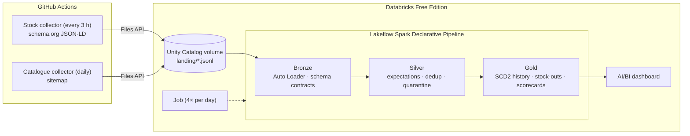

# Rituals Radar

**Stock monitoring for Rituals products, built end-to-end on Databricks Free Edition.**

Every 3 hours the radar checks whether every product of the current **Limited Edition** (the Uukumwe Collection) is in stock on rituals.com/nl-nl and records price changes. The product list comes from the sitemap on each run, so new items in the collection are picked up automatically. Once a day it snapshots the sitemap to spot new and delisted products. A Lakeflow pipeline turns the raw checks into a compact stock history, stock-out periods with their duration, and scorecards per product and collection. An AI/BI dashboard sits on top.

> Non-commercial portfolio project. It is not affiliated with Rituals Cosmetics.

## Questions it answers

- Which Limited Edition products are sold out right now, since when, and how often did that happen in the last 30 days?
- Which collections are hardest to get?
- How do prices and discounts change over time?
- Which new products appeared in the catalogue?

## Architecture



**Why the collectors run outside Databricks:** Free Edition only allows outbound traffic to a small allowlist of domains, so notebooks can't reach rituals.com. GitHub Actions fetches the pages and uploads raw JSON Lines to a Unity Catalog volume, and everything after that happens in Databricks. If your workspace does get internet access, for example after the optional LinkedIn verification, the same code can run as a Databricks job instead (`resources/optional/`).

## Data engineering highlights

| Concept | Where | Why it matters |
|---|---|---|
| Medallion architecture (bronze → silver → gold) | `src/pipeline/transformations/` | Raw data is kept and can be replayed; every layer has one job |
| Incremental ingestion with Auto Loader | `01_bronze.py` | Only new files are processed, each exactly once |
| Data contracts | `radar/records.py` ↔ `01_bronze.py`, enforced by `tests/test_contracts.py` | A renamed field fails CI instead of silently becoming `NULL`; unexpected values land in `_rescued_data` |
| Declarative data quality + quarantine | `02_silver.py` | Expectations drop or flag bad rows, with counts in the event log; failed checks go to `silver_stock_quarantine` |
| SCD Type 2 with `AUTO CDC` | `03_gold_history.py` | ~6,500 checks a month collapse into a few hundred history rows; out-of-order data is handled |
| Gaps-and-islands SQL | `04_gold_marts.sql` (`gold_stockout_events`) | Turns history versions into stock-out periods with durations |
| Infrastructure as code | `databricks.yml`, `resources/` | Schema, volume, pipeline, job and dashboard are all deployed with one command |
| CI/CD | `.github/workflows/` | Tests run on every push, and ingestion runs on a schedule |
| Responsible scraping | `radar/rituals.py`, `radar/http_client.py` | Respects robots.txt, sends an honest User-Agent, waits 3 s between requests, and reads structured data instead of the visual layout |

### A finding that shaped the scraper

The text *"Dit product is online tijdelijk uitverkocht"* ("this product is temporarily sold out online") appears in the HTML of **every** product page, including products that are in stock, because it is part of the embedded translation bundle. A scraper that searches for that text would report everything as sold out. The radar reads `offers.availability` from the schema.org JSON-LD instead, the same data Google Shopping uses. `tests/test_rituals.py` has a regression test for this.

## Data model

| Layer | Table | Contents |
|---|---|---|
| Bronze | `bronze_rituals_stock`, `bronze_rituals_catalog` | Raw records plus lineage (`source_file`, `ingested_at`, `_rescued_data`) |
| Silver | `silver_stock_snapshots` | Successful stock checks, deduplicated, with discount and local date |
| | `silver_stock_quarantine` | Failed checks (blocked, HTTP errors, layout changes) |
| | `silver_catalog_snapshots` | Products listed in the sitemap per crawl |
| Gold | `gold_stock_history` | Availability and price history (AUTO CDC, SCD2) |
| | `gold_stock_current`, `gold_stock_daily`, `gold_collection_availability_daily` | Current status and daily availability |
| | `gold_stockout_events` | Stock-out periods with start, end and duration |
| | `gold_catalog_products` | First and last seen, still listed, new launches |
| | `gold_collection_scorecard`, `gold_product_scorecard` | Availability, stock-outs and hours sold out (last 30 days) |

## Dashboard

Two pages, defined as code in `src/dashboards/rituals_radar.lvdash.json`:

1. **Stock monitor:** KPIs, current status per product, availability trend for the six weakest collections, the products sold out longest, and what is sold out right now.
2. **Collections & catalogue:** a scorecard per collection, availability per collection, products on discount, and new products in the sitemap.

Until real data arrives, the dashboard runs on generated sample data (`is_sample = true`), in which limited and seasonal products sell out more often as the season approaches.

## Getting started

The full step-by-step guide, in Dutch, is in **[docs/HANDLEIDING.md](docs/HANDLEIDING.md)**. Short version:

```bash
databricks auth login --host https://<your-workspace>.cloud.databricks.com
databricks bundle deploy
# run src/notebooks/01_load_sample_data in the workspace, then:
databricks bundle run rituals_radar_refresh
# real data: add the GitHub secrets DATABRICKS_HOST and DATABRICKS_TOKEN,
# then run the "collect" workflow from the Actions tab.
```

Run locally (Python 3.11+):

```bash
pip install -r requirements-dev.txt
pytest                                                   # unit tests, no network
PYTHONPATH=src/collectors python -m radar check
PYTHONPATH=src/collectors python -m radar stock --dry-run
PYTHONPATH=src/collectors python -m radar sample --out landing_local
```

## Project structure

```
├── databricks.yml                  bundle: variables and target
├── resources/                      schema + volume, pipeline, job, dashboard (+ optional collector jobs)
├── config/radar.toml               watchlist, collections/keywords, politeness settings
├── src/
│   ├── collectors/radar/           Python collectors (run in GitHub Actions)
│   ├── pipeline/transformations/   01_bronze.py · 02_silver.py · 03_gold_history.py · 04_gold_marts.sql
│   ├── notebooks/                  connectivity check, sample data, exploration, collectors in Databricks
│   └── dashboards/                 AI/BI dashboard definition
├── tests/                          pytest: parser, matching, contracts, sample data, dashboard, bundle
└── .github/workflows/              collect (schedule) and ci (tests)
```

## Limitations

- "In stock" means *orderable online on the Dutch webshop*. It says nothing about store stock or quantities. Timestamps are only as precise as the check interval (3 hours).
- The JSON-LD offer price can differ from the price shown on the page (for example outlet or member prices); both are stored.

## Ideas for next steps

- A SQL alert or e-mail when a watched product sells out.
- A file-arrival trigger on the volume instead of a fixed schedule.
- A Genie space for asking questions about the data in natural language.
- More shops (Douglas, bol) to compare availability across retailers.

## Responsible use

This project reads public product pages at a low rate, follows robots.txt and identifies itself. Databricks Free Edition is meant for non-commercial use, and so is this project. Respect the terms of rituals.com, and stop when asked.
